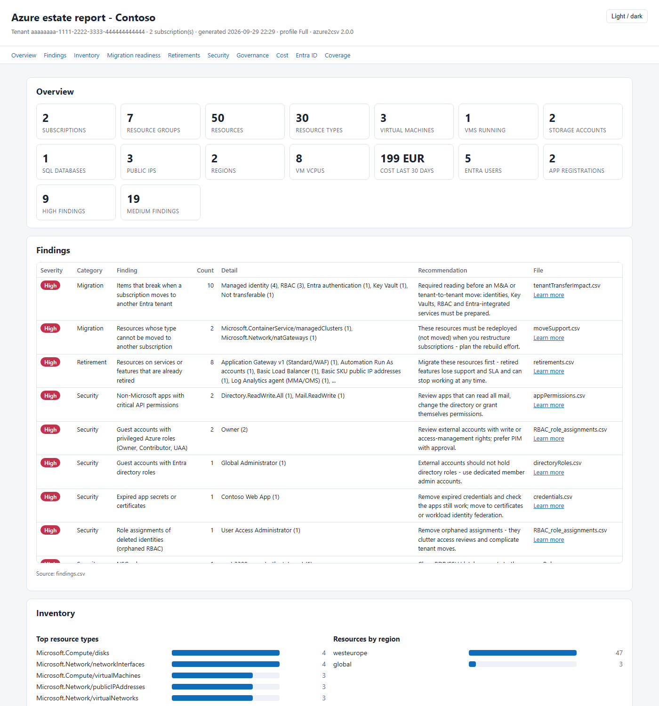

# azure2csv

**Inventory a whole Azure tenant in minutes and get a migration-readiness view of it.** The output is CSV files, an
optional Excel workbook and a self-contained HTML dashboard. It covers resources, networking, RBAC, Azure Policy,
Entra ID, diagnostic settings, backup, retirements and orphaned resources, plus what can (and cannot) be moved.

On request it also writes a **configuration snapshot**: every resource as a JSON file with its properties uncut, the
child resources Resource Graph does not list, and Azure's own ARM template and Bicep export of every resource group.
That is a documented starting point for rebuilding an environment, not a backup
([details and limits](#configuration-snapshot)).

- **Read-only.** The script never changes anything in Azure or Entra ID.
- **One file, one dependency.** It needs only `Az.Accounts` and runs on Windows PowerShell 5.1, PowerShell 7 and
  Azure Cloud Shell.
- **Fast.** Bulk data comes from Azure Resource Graph, so large tenants take minutes, not hours.
- **Shareable.** `-Mask` pseudonymizes names, IDs, UPNs and public IPs, so you can send the results to a colleague
  or consultant.



> Sample reports built from a fictional tenant are in [`docs/sample`](docs/sample) and
> [`docs/sample-masked`](docs/sample-masked). Open `summary.html` in a browser.

## Why

I wrote the first version in 2021 while designing hybrid, multi-cloud DNS: I needed every VNet, NIC and private DNS
link in one place ([original post](https://it4it.solutions/2021/10/15/inventory-all-azure-resources-to-csv-file/)).
Since then I have used the script at the start of every migration project.

Version 2 adds the reports I promised back then. It also covers the questions every migration starts with:
- What do we have?
- What is retiring?
- What is unused?
- What can be moved to another subscription or region?
- What breaks if the subscription moves to another tenant?
- Which policies will block the target design?

## What it is good for

**A record you can search later.** Every run writes a folder named with the date and time. Keep them: each one shows
what the environment looked like on that day. When someone asks months later which machine had `10.20.3.14`, or where
a VM that no longer exists was connected, open the workbook of that run and press Ctrl+F (set "Within" to
"Workbook"), or search every folder you kept:

```powershell
Get-ChildItem .\azure2csv_* -Recurse -Include *.csv, *.json, *.bicep | Select-String -SimpleMatch '10.20.3.14' -List
```

The logs answer a different question. The activity log says who did what and when, and Azure keeps it for 90 days
unless you export it; Resource Graph keeps change history for 14 days. Neither is made to show what a resource that
was deleted last year looked like. The inventory only knows the days on which it ran, so run it regularly (monthly,
and before and after every migration wave) and keep the zip files. It reuses the Az sign-in that is already active,
so it can also run from a scheduled task or a pipeline.

**Migrations.** The goal is to collect as much metadata as a reader is allowed to see: sizes, addresses, DNS records,
firewall rules, dependencies, identities, role assignments, locks, policies, backup settings. The folder made before
a migration wave is the reference for "how was this configured before we touched it?". It does not cover everything.
**If something you need is missing, [open an issue](https://github.com/AleksandrReznik/Azure2csv/issues)** with the
resource type and the setting, and I will try to add it.

**AI analysis without giving AI access to Azure.** The output is plain files (CSV, JSON, Bicep). Give the folder to
an AI assistant and ask your questions: the assistant has no credentials, cannot call Azure and cannot change
anything. With a model that runs on your own computer nothing leaves your network. With a hosted AI service the files
themselves go to that service, so run with `-Mask` first. Tell the assistant to start with `coverage.csv` (what was
collected and what was skipped) and `snapshot\index.csv` (every JSON file), and check its answers against the files.

## Quick start

**Azure Cloud Shell** (PowerShell). Az is preinstalled; files in `~/clouddrive` persist:

```powershell
Invoke-WebRequest https://raw.githubusercontent.com/AleksandrReznik/Azure2csv/main/azure2csv.ps1 -OutFile ~/clouddrive/azure2csv.ps1
~/clouddrive/azure2csv.ps1 -Profile Quick -OutputPath ~/clouddrive -Zip
```

Download the zip with **Manage files > Download**.

**Your own machine** (Windows, macOS or Linux):

```powershell
Install-Module Az.Accounts -Scope CurrentUser          # once
Install-Module ImportExcel -Scope CurrentUser          # optional: Excel workbook
Connect-AzAccount                                      # or let the script sign you in
.\azure2csv.ps1                                        # Standard profile, all subscriptions you can read
```

If you downloaded the file from the internet on Windows, run `Unblock-File .\azure2csv.ps1` once.

## Choosing what to collect

| Parameter | What it does | Example |
|---|---|---|
| `-Profile` | Picks a ready-made set. The default is `Standard`. | `-Profile Migration` |
| `-Reports` | Runs exactly these reports and/or groups; the profile is ignored. | `-Reports RBAC, Policy` |
| `-AddReports` | Adds reports to the profile. | `-AddReports Cost, EntraGroupMembers` |
| `-SkipReports` | Removes reports from the selection. | `-SkipReports DiagnosticSettings, Entra` |
| `-ListReports` | Prints the catalog, or the resolved selection with speed info, and exits without contacting Azure. | `-Profile Security -ListReports` |

**Profiles:**

| Profile | Contents |
|---|---|
| `Quick` | Every report based on Resource Graph: inventory, network, compute, data, monitoring, Defender plans, Lighthouse. Runs in minutes; good for Cloud Shell. |
| `Standard` | Quick, plus diagnostic settings, RBAC (with PIM and deny assignments), locks, Azure Policy, resource providers, tenant transfer and Entra ID (without group members). |
| `Full` | Everything, including the opt-in reports Snapshot, ArmTemplates, ChildResources, Cost, AzureCode, AzureDevOpsPipelines, EntraGroupMembers and EntraAppAssignments (not AzureDevOpsRepos, AzureDevOpsPackages and AppCode, which run only when named). |
| `Migration` | Inventory, network, compute, data, monitoring, backup, move support, cross-references, locks, RBAC, Policy, resource providers, tenant transfer, managed identities, retirements, orphans. |
| `Security` | RBAC, Defender plans, Lighthouse, Entra ID with Conditional Access (when readable), NSG rules, firewalls, application gateways, gateways, public IPs, private endpoints, storage, SQL, Key Vault, diagnostic settings, Policy, Advisor, locks, retirements. |
| `Governance` | Management groups, Policy, RBAC, Defender plans, Lighthouse, resource providers, locks, tags, diagnostic settings, Advisor. |

**Scope:** `-TenantId`, `-SubscriptionId` (array or comma list), `-ExcludeSubscriptionId`, `-ManagementGroupId`.

**Output:** `-OutputPath`, `-Zip`, `-Mask`, `-NoExcel`, `-NoHtml`, `-Delimiter`.

```powershell
.\azure2csv.ps1 -Profile Quick                                        # fast first look
.\azure2csv.ps1 -Reports RBAC, Policy, ManagementGroups               # governance only
.\azure2csv.ps1 -Profile Migration -AddReports Cost -SkipReports Entra
.\azure2csv.ps1 -Reports VMs, Disks, Backup -SubscriptionId <sub1>,<sub2>
.\azure2csv.ps1 -Profile Full -Mask                                   # everything, safe to share
.\azure2csv.ps1 -ListReports                                          # what can I choose?
```

The same lists work when the script is started from cmd, a scheduler or with `pwsh -File`, with or without spaces
after the commas:

```powershell
pwsh -File .\azure2csv.ps1 -Profile Full -AddReports AzureDevOpsRepos, AzureDevOpsPackages, AppCode
```

## Reports

<!-- reports:start -->
| Group | Report | Files | Speed | In profiles | What it contains |
|---|---|---|---|---|---|
| Inventory | `Resources` | allResources.csv, subscriptions.csv, resourceTypes.csv | Fast | Quick, Standard, Full, Migration | Every resource plus subscription and resource-group rows (v1 allResources.csv columns first), VM IPs/VNet/DNS |
| Inventory | `Tags` | tags.csv, tagList.json | Fast | Quick, Standard, Full, Migration, Governance | Tag names and values with usage counts (subscriptions, resource groups, resources) |
| Inventory | `DiagnosticSettings` | diagnosticSettings.csv (+ DiagStatus/DiagnosticSettings columns) | Slow | Standard, Full, Security, Governance | Diagnostic settings of every resource and the subscription activity log |
| Inventory | `MoveSupport` | moveSupport.csv (+ CanMoveTo* columns) | Fast | Quick, Standard, Full, Migration | Can each resource type move to another resource group / subscription / region (Microsoft Learn data) |
| Inventory | `CrossReferences` | crossReferences.csv | Fast | Quick, Standard, Full, Migration | Resources that reference resources in another resource group or subscription (move blockers) |
| Inventory | `Locks` | locks.csv | Medium | Standard, Full, Migration, Security, Governance | Management locks (CanNotDelete/ReadOnly) on subscriptions, resource groups and resources |
| Inventory | `Snapshot` \* | snapshot\ folder: one JSON file per resource and object, snapshot\index.csv | Medium | Full | Configuration snapshot: every resource as a JSON file with its properties uncut (a CSV cell is cut), firewall rules, DNS records, backup policies and other items of the other Resource Graph tables, plus the role, policy, lock, diagnostic, child resource and Entra objects the selected reports collected - opt-in, never with -Mask |
| Inventory | `ArmTemplates` \* | templates\ folder: an ARM template (.json) and a Bicep file per resource group, templates\index.csv, templates\notExported.csv | Slow | Full | Azure's own template export of every resource group as ARM JSON and Bicep (-TemplateFormat), with the list of what Azure could not export. A starting point for infrastructure as code, not a tested deployment - opt-in, never with -Mask |
| Inventory | `ChildResources` \* | childResources.csv, childResourceTypes.csv, storageContainers.csv, storageFileShares.csv, sqlFirewallRules.csv, keyVaultObjects.csv, serviceBusEntities.csv, eventHubs.csv, privateEndpointDnsZoneGroups.csv (+ the items as JSON in snapshot\ with the Snapshot report) | Slow | Full | What Resource Graph does not list: storage containers and file shares, SQL firewall rules and retention, Service Bus queues and topics, Event Hubs, Cosmos DB databases and containers, Automation schedules and variables, DNS records, private endpoint DNS zone groups, Key Vault key and secret names (never values) and more - several calls per resource, opt-in |
| Network | `VirtualNetworks` | vnets.csv, subnets.csv, peerings.csv | Fast | Quick, Standard, Full, Migration | VNets (address space, DNS), subnets (NSG, route table, service endpoints, delegations), peerings |
| Network | `NetworkSecurity` | nsgs.csv, nsgRules.csv | Fast | Quick, Standard, Full, Migration, Security | NSGs with associations and every rule (one row per rule, default rules included) |
| Network | `Routing` | routeTables.csv, routes.csv | Fast | Quick, Standard, Full, Migration | Route tables with associated subnets and every route |
| Network | `PublicIPs` | publicIps.csv | Fast | Quick, Standard, Full, Migration, Security | Public IP addresses, SKU, allocation and what they are attached to |
| Network | `PrivateEndpoints` | privateEndpoints.csv | Fast | Quick, Standard, Full, Migration, Security | Private endpoints, target resources, IPs and DNS names |
| Network | `PrivateDNS` | privateDnsZones.csv, privateDnsLinks.csv (+ linkedPrivDNSzones column) | Fast | Quick, Standard, Full, Migration | Private DNS zones with their VNet links (v1 report) |
| Network | `NetworkInterfaces` | networkInterfaces.csv | Fast | Quick, Standard, Full, Migration | Network interfaces: IP addresses, subnets, NSG, application security groups, load balancer pools, DNS servers, accelerated networking |
| Network | `LoadBalancers` | loadBalancers.csv, loadBalancerFrontends.csv, loadBalancerRules.csv, loadBalancerProbes.csv | Fast | Quick, Standard, Full, Migration | Load balancers with their frontends, load-balancing rules and health probes |
| Network | `AppGateways` | applicationGateways.csv, applicationGatewayListeners.csv, applicationGatewayRules.csv, applicationGatewayBackends.csv, applicationGatewayBackendSettings.csv, wafPolicies.csv | Fast | Quick, Standard, Full, Migration, Security | Application gateways with listeners, routing rules, backend pools and settings; web application firewall policies |
| Network | `Firewalls` | firewalls.csv, firewallPolicies.csv, firewallRules.csv, ipGroups.csv | Fast | Quick, Standard, Full, Migration, Security | Azure Firewalls, firewall policies with every rule (one row per rule) and IP groups |
| Network | `Gateways` | virtualNetworkGateways.csv, localNetworkGateways.csv, connections.csv, expressRouteCircuits.csv, virtualWans.csv, virtualHubs.csv, natGateways.csv, bastionHosts.csv | Fast | Quick, Standard, Full, Migration, Security | VPN and ExpressRoute gateways, local network gateways, connections, ExpressRoute circuits, Virtual WAN and hubs, NAT gateways, Bastion |
| Network | `DnsRecords` | dnsRecords.csv | Fast | Quick, Standard, Full, Migration | Every record set of the public and private DNS zones |
| Compute | `VMs` | vms.csv | Fast | Quick, Standard, Full, Migration | VM migration profile: size, vCPU/RAM, OS, image, power state, disks, IPs, agents, backup |
| Compute | `Disks` | disks.csv | Fast | Quick, Standard, Full, Migration | Managed disks: SKU, size, state, owner VM, encryption, network access |
| Compute | `AKS` | aks.csv | Fast | Quick, Standard, Full, Migration | AKS clusters: version, tier, node pools, network, Entra integration |
| Compute | `AppService` | appServicePlans.csv, appServiceApps.csv | Fast | Quick, Standard, Full, Migration | App Service plans and web/function apps with runtime stacks and TLS settings |
| Compute | `ScaleSets` | vmScaleSets.csv | Fast | Quick, Standard, Full, Migration | Virtual machine scale sets: size, capacity, image, disks, subnets, load balancer pools, upgrade and scale-in policy |
| Compute | `ContainerRegistries` | containerRegistries.csv | Fast | Quick, Standard, Full, Migration | Container registries: SKU, admin user, network rules, retention, encryption |
| Compute | `ContainerApps` | containerApps.csv, containerAppEnvironments.csv, containerInstances.csv | Fast | Quick, Standard, Full, Migration | Container Apps with ingress, images, scale and secret names; their environments; container instances |
| Data | `Storage` | storageAccounts.csv | Fast | Quick, Standard, Full, Migration, Security | Storage accounts: kind, SKU, TLS, public/shared-key access, network rules, encryption |
| Data | `SQL` | sqlServers.csv, sqlDatabases.csv, sqlManagedInstances.csv, sqlVirtualMachines.csv | Fast | Quick, Standard, Full, Migration, Security | Azure SQL servers, databases, managed instances and SQL Server on VMs (versions, editions, licensing) |
| Data | `KeyVault` | keyVaults.csv | Fast | Quick, Standard, Full, Migration, Security | Key Vaults: RBAC vs access policies, soft delete, purge protection, network access |
| Data | `Databases` | cosmosDbAccounts.csv, postgresFlexibleServers.csv, mysqlFlexibleServers.csv, redisCaches.csv | Fast | Quick, Standard, Full, Migration | Cosmos DB accounts, PostgreSQL and MySQL flexible servers, Azure Cache for Redis: version, size, high availability, backup, network access |
| Data | `Messaging` | serviceBusNamespaces.csv, eventHubNamespaces.csv, eventGridTopics.csv | Fast | Quick, Standard, Full, Migration | Service Bus and Event Hubs namespaces, Event Grid topics and domains |
| Operations | `Monitoring` | logAnalyticsWorkspaces.csv, applicationInsights.csv, alertRules.csv, actionGroups.csv, dataCollectionRules.csv, autoscaleSettings.csv | Fast | Quick, Standard, Full, Migration | Log Analytics workspaces, Application Insights, alert rules with their action groups, data collection rules, autoscale settings |
| Operations | `Backup` | backupItems.csv | Fast | Quick, Standard, Full, Migration | Protected items of Recovery Services and Backup vaults (VMs, SQL, SAP HANA, files, disks, blobs) |
| Operations | `Automation` | automationAccounts.csv, runbooks.csv | Fast | Quick, Standard, Full, Migration | Automation accounts and runbooks (type, state, runtime) |
| Operations | `AzureCode` \* | code\ folder, code\index.csv (+ UsesAzureRM/UsesRunAs/ExportedFile columns in runbooks.csv) | Slow | Full | Export code stored in Azure: runbooks, DSC, Logic Apps, Data Factory, Stream Analytics, template specs, deployment scripts, custom policies and roles, workbooks, dashboards, alert queries, Sentinel rules, API Management (may contain secrets - opt-in, never with -Mask) |
| Operations | `AppCode` \*\* | code\<subscription>\<resource group>\<app>\wwwroot\ (+ code\index.csv) | Slow |  | Download the files of every Function App and Web App (Kudu zip of wwwroot) - only when named, needs publish rights, never with -Mask |
| Operations | `Advisor` | advisor.csv | Fast | Quick, Standard, Full, Security, Governance | Azure Advisor recommendations (cost, security, reliability, performance, operations) |
| Operations | `Retirements` | retirements.csv | Fast | Quick, Standard, Full, Migration, Security | Resources affected by Azure retirements (built-in rules + Advisor), with dates and actions |
| Operations | `Orphans` | orphans.csv | Fast | Quick, Standard, Full, Migration | Orphaned/unused resources: unattached disks, unused public IPs, NICs, NSGs, empty resource groups... |
| Operations | `Cost` \* | cost.csv (+ Cost column) | Slow | Full | Actual cost per resource for the last -CostDays days (Cost Management API) |
| Operations | `AzureDevOps` | ADO\ folder: organizations, projects, repositories, pipelines, service connections, agents, users... | Slow | Standard, Full, Migration, Security | Azure DevOps organizations billed to the subscriptions or named with -AdoOrganization: projects, Git and TFVC repos, pipelines, service connections, agents, users, feeds and packages, integrations, work items |
| Operations | `AzureDevOpsPipelines` \* | ADO\<organization>\<project>\pipelines\ folder (+ ExportedFile columns) | Slow | Full | Export every Azure DevOps pipeline: YAML files from Azure Repos, pipeline and release definitions as JSON (settings included - opt-in, never with -Mask) |
| Operations | `AzureDevOpsRepos` \*\* | ADO\<organization>\<project>\repos\ folder (+ ExportedTo columns) | Slow |  | Export the default branch of every Azure DevOps Git repository and every TFVC branch (files, no history; up to -AdoRepoMaxSizeMB each) - only when named, never with -Mask |
| Operations | `AzureDevOpsPackages` \*\* | ADO\<organization>\<project>\feeds\ folder (+ ExportedTo column in packages.csv) | Slow |  | Download the packages published to Azure Artifacts feeds, Universal Packages with Microsoft ArtifactTool (latest versions, or all with -AdoPackageVersions All; up to -AdoPackagesMaxMB) - only when named, never with -Mask |
| Governance | `ManagementGroups` | managementGroups.csv | Fast | Quick, Standard, Full, Migration, Governance | Management group hierarchy and where every subscription sits |
| Governance | `Policy` | policyAssignments.csv, policyDefinitions.csv, policySetDefinitions.csv, policyExemptions.csv, policyCompliance.csv | Medium | Standard, Full, Migration, Security, Governance | Azure Policy assignments (incl. inherited and at management groups without subscriptions), definitions, initiatives, exemptions and compliance |
| Governance | `RBAC` | RBAC_role_assignments.csv, RBAC_roles.csv, RBAC_eligible_assignments.csv, RBAC_deny_assignments.csv | Medium | Standard, Full, Migration, Security, Governance | Role assignments with resolved principals (orphaned, guests), time-bound and eligible assignments (PIM), deny assignments, custom/used role definitions |
| Governance | `Defender` | defenderPlans.csv | Fast | Quick, Standard, Full, Migration, Security, Governance | Microsoft Defender for Cloud plans of every subscription: tier, sub-plan and extensions |
| Governance | `Lighthouse` | lighthouse.csv | Fast | Quick, Standard, Full, Migration, Security, Governance | Azure Lighthouse: subscriptions and resource groups delegated to another tenant, with the roles given |
| Governance | `ResourceProviders` | resourceProviders.csv | Medium | Standard, Full, Migration, Governance | Resource providers registered in every subscription, with the number of resources that use them |
| Governance | `TenantTransfer` | tenantTransferImpact.csv | Medium | Standard, Full, Migration | What breaks when a subscription moves to another Entra tenant (identities, Key Vault, RBAC, policy...) |
| Entra | `EntraTenant` | entraTenant.csv, entraDomains.csv, entraLicenses.csv, entraAdministrativeUnits.csv, entraSettings.csv | Fast | Standard, Full, Security | Tenant information, domains (managed/federated), license SKUs, administrative units and directory settings (group creation, naming, guest access) |
| Entra | `EntraUsers` | entraUsers.csv | Medium | Standard, Full, Security | Users and guests: enabled, sync, licenses, last sign-in (when permitted) |
| Entra | `EntraGroups` | entraGroups.csv | Medium | Standard, Full, Security | Groups: type, dynamic rules, role-assignable, sync, use in Azure RBAC |
| Entra | `EntraGroupMembers` \* | entraGroupMembers.csv | Slow | Full | Membership of every group (users, groups, service principals) - one call per group |
| Entra | `EntraApps` | entraApplications.csv, entraServicePrincipals.csv, managedIdentities.csv, credentials.csv, appPermissions.csv | Medium | Standard, Full, Migration, Security | App registrations, enterprise apps, managed identities, secret/certificate expiry, API permissions |
| Entra | `EntraAppAssignments` \* | entraAppAssignments.csv | Slow | Full | Users, groups and applications assigned to every enterprise application - one call per application |
| Entra | `EntraRoles` | directoryRoles.csv, entraRoleDefinitions.csv | Medium | Standard, Full, Security | Entra ID directory role assignments (active; PIM eligibility is not readable with the Az token) and custom role definitions |
| Entra | `EntraPolicies` | entraConditionalAccess.csv, entraNamedLocations.csv, entraPolicySettings.csv | Fast | Standard, Full, Security | Conditional Access policies, named locations and tenant-wide policies (authorization, security defaults, authentication methods, cross-tenant access) when the sign-in may read them |
<!-- reports:end -->

\* Opt-in: only in `-Profile Full` or when named in `-Reports` / `-AddReports`.
\*\* Only when named in `-Reports` / `-AddReports` (not in `-Profile Full`).

The files of the newer reports (load balancers, application gateways, firewalls, gateways, DNS records, network
interfaces, scale sets, container registries and apps, databases, messaging, monitoring, and the typed child
resource files) are written only when there is something to list: no ExpressRoute circuit, no
`expressRouteCircuits.csv`. `coverage.csv` still says the report was built.

**Every run also writes:**
- `summary.html`
- `findings.csv`: about 48 checks with severity, count, recommendation and a Microsoft Learn link.
- `coverage.csv`: what was collected, skipped (and why) or not selected.
- `yyyyMMdd-HHmmss__run.json`: timings, API calls, versions.
- `yyyyMMdd-HHmmss__general_log.txt` (same time as the folder name): everything the run reported, written line by
  line. It stays complete even if the window closes or the run stops on an error.
- The Excel workbook, when ImportExcel is installed.

## What the migration columns mean

| Column (allResources.csv) | Meaning |
|---|---|
| `CanMoveToOtherRG` / `CanMoveToOtherSubscription` / `CanMoveToOtherRegion` | Whether Azure supports moving this resource type without a rebuild. Values: `Yes`, `No`, `Partial` (for example it depends on the SKU; see `MoveNotes`), `Pending`, `Manual` or `Unknown`. The source is Microsoft's official table, downloaded at run time. Use `-MoveSupportFile` offline. |
| `PrivateIP`, `PublicIP`, `vnet`, `subnet`, `vnetDNS`, `vnicDNS`, `linkedPrivDNSzones`, `NicNSG`, `SubnetNSG`, `ASG`, `RouteTable` | Networking of VMs, NICs and VNets, joined by resource ID across resource groups and subscriptions. |
| `DiagStatus` | `Configured`, `NotConfigured`, `NotSupported` or `Error`. |
| `PolicyNonCompliant` | Number of non-compliant policy states of the resource. |
| `Cost` | Actual cost for the last `-CostDays` days, when the Cost report is selected. |

`crossReferences.csv` lists resources that point to resources in other resource groups or subscriptions. These must
move together. `tenantTransferImpact.csv` lists what breaks when a subscription moves to another Microsoft Entra
tenant.

## Configuration snapshot

The CSV reports are made for people: one row per thing, the columns that matter. Three opt-in reports add the
detail you need when the goal is to document an environment in depth, compare it over time, or rebuild it:

```powershell
.\azure2csv.ps1 -AddReports Snapshot, ArmTemplates, ChildResources      # on top of the Standard profile
.\azure2csv.ps1 -Profile Full                                           # these three and every other opt-in report
```

| Report | What it writes | Cost |
|---|---|---|
| `Snapshot` | `snapshot\`: one JSON file per object, in a path that mirrors its Azure ID: `snapshot\<subscription>\<resource group>\<provider>\<type>\<name>.json`. Every resource with its properties uncut, as Resource Graph returns them (a CSV cell is cut at 32,000 characters, the file is not), the rows of 14 more Resource Graph tables (DNS records, firewall policy rules, backup policies, App Service configuration, data collection rule associations...), and everything the other selected reports collected: role and policy assignments and definitions, locks, diagnostic settings, child resources, Entra objects. `snapshot\index.csv` lists every file. | A few Resource Graph queries |
| `ArmTemplates` | `templates\<subscription>\<resource group>.json` and `.bicep`: Azure's own "Export template" for every resource group, written exactly as Azure returns it. `templates\index.csv` lists every resource group with its files or why it was not exported; `templates\notExported.csv` lists what Azure itself reported as missing from a template. `-TemplateFormat Json` or `Bicep` halves the calls. | 1 to 2 calls per resource group |
| `ChildResources` | `childResources.csv` and typed files (`storageContainers.csv`, `storageFileShares.csv`, `sqlFirewallRules.csv`, `keyVaultObjects.csv`, `serviceBusEntities.csv`, `eventHubs.csv`, `privateEndpointDnsZoneGroups.csv`): what Resource Graph does not list. Blob containers, file shares, queues and tables, lifecycle policies, SQL firewall and network rules, failover groups, auditing and retention, Service Bus queues, topics and subscriptions, Event Hubs and consumer groups, Event Grid subscriptions, Cosmos DB databases and containers with their throughput, PostgreSQL and MySQL databases and changed server parameters, Automation schedules, variables and modules, Log Analytics custom tables and saved searches, API Management products, backends and named values, Front Door routes and origins, private endpoint DNS zone groups, DNS record sets, federated credentials of managed identities, Key Vault key and secret names. `childResourceTypes.csv` shows what was asked, with which API version, and what was refused. | Several calls per resource: slow on large tenants |

**What it is, and what it is not.** It is a configuration snapshot: documentation, audit evidence, something to
diff against next month, and the material to rebuild from, by hand or with infrastructure as code. It is not a
backup and you cannot restore from it:

- **No data and no secrets.** Blobs, databases, disk contents, messages and logs are not read. Neither are storage
  keys, app settings and connection strings, Key Vault secret values, VM extension protected settings, certificate
  private keys or VPN shared keys. For Key Vault only the names, types and expiry dates of keys and secrets are
  listed. Azure returns a few secrets to a reader inside resource properties (ExpressRoute authorization keys, the
  shared key of some connections): the values of about 25 such well-known properties are replaced with
  `(not exported)` in every output, and `coverage.csv` says how many.
- **Exported templates are a starting point.** Microsoft's export leaves out some resource types and settings
  (`templates\notExported.csv` lists them per resource group), and a template usually needs editing before it deploys:
  references to other resource groups, globally unique names, secrets. Azure exports at most 200 resources in one
  call; larger resource groups are exported in parts.
- **Not everything is covered.** The child resource table covers about 40 resource types that hold most of a
  design; other types have children the script does not ask for. What runs inside a VM or an AKS cluster is outside
  Azure Resource Manager altogether.
- **Not one point in time.** A run takes minutes to hours and Resource Graph lags a little behind changes.
- **Identities do not transfer.** Role assignments and access policies name object IDs of this tenant.

None of the three runs with `-Mask`: whole definitions cannot be pseudonymized reliably.

## Azure DevOps inventory

The `AzureDevOps` report looks for the Azure DevOps organizations your subscriptions point to:
- billing links (`Microsoft.VisualStudio/account` resources)
- Managed DevOps Pools
- pipeline agent VM extensions
- any organization you name: `-AdoOrganization contoso, https://dev.azure.com/fabrikam`

It connects with your existing Az sign-in (an Entra token, no personal access token). An organization you cannot
access gets a "No access" row; one that belongs to another Entra tenant says so. The other organizations connected to
your tenant are listed as "Listed only" (name them with `-AdoOrganization` to inventory them).

```
ADO\
  organizations.csv            every organization: source, status, owner, billing subscription, totals
  <organization>\              one folder per organization that was read
    projects.csv ... processes.csv
    <project>\
      pipelines\               with the AzureDevOpsPipelines report (below)
      repos\<repository>\      with the AzureDevOpsRepos report (below)
      repos\TFVC\<branch>\     TFVC branches, with the AzureDevOpsRepos report
      feeds\<feed>\            with the AzureDevOpsPackages report (below)
    feeds\<feed>\              organization-scoped feeds, with the AzureDevOpsPackages report
```

| File (in `ADO\<organization>\`) | Content |
|---|---|
| `projects.csv` | Visibility (public projects are a finding), process, Git or TFVC, last update, counts |
| `repositories.csv` | Git repositories: size, default branch, last commit, branch policies on the default branch |
| `tfvc.csv` | TFVC branches (or the whole `$/<project>` when it has no branches): parent, owner, created, last changeset, files, size, pipelines that map them |
| `pipelines.csv`, `releasePipelines.csv` | YAML or classic, repository source, agent pool, last run and result |
| `serviceConnections.csv` | Type, authentication (workload identity federation or secret), Azure subscription, identity, secret expiry, Azure roles |
| `agentPools.csv`, `agents.csv` | Microsoft-hosted, self-hosted, scale set and Managed DevOps Pools; agent version, status, last job, matching Azure VM |
| `users.csv`, `admins.csv` | License, origin (Entra, Microsoft account), guest, last access; administrator group members |
| `variableGroups.csv`, `secureFiles.csv` | Variable names and secret flags, Key Vault links, files to re-upload |
| `environments.csv`, `deploymentGroups.csv` | Deployment targets, approvals and checks, target machines |
| `extensions.csv`, `serviceHooks.csv` | Marketplace extensions, integrations (target host only) |
| `feeds.csv`, `feedPermissions.csv` | Azure Artifacts feeds: published and upstream-cached packages, protocols, last publish, upstream sources, views, retention; who has which feed role |
| `packages.csv` | One row per package version: protocol, latest, listed, views, published or cached from an upstream source, publish date, downloads and last download of the package |
| `workItems.csv`, `processes.csv` | Work item counts per project and type, custom processes |

Secret values are never read. Variable groups list only variable names and whether they are secret. Service hooks keep
only the target host, because hook URLs can carry tokens. Agent capabilities (the agent's environment variables) are
not exported.

**Pipeline export (opt-in).** Add the `AzureDevOpsPipelines` report to also export every pipeline to
`ADO\<organization>\<project>\pipelines\<pipeline folder>\`:
- `<pipeline>.yml`: the YAML file, for YAML pipelines in Azure Repos
- `<pipeline>.json`: the pipeline definition (classic and YAML)
- `releases\<release pipeline>.json`: classic release pipelines

```powershell
.\azure2csv.ps1 -Reports AzureDevOps, AzureDevOpsPipelines
```

Azure DevOps never returns secret values, but definitions contain settings and non-secret variables. That is why the
export is off by default and never runs with `-Mask`. The `ExportedFile` column of `pipelines.csv` and
`releasePipelines.csv` points to the files.

**Repository export (only when named).** The `AzureDevOpsRepos` report downloads the default branch of every Git
repository to `ADO\<organization>\<project>\repos\<repository>\` and the latest version of every TFVC branch to
`...\repos\TFVC\<branch path>\` (`$/Shop/Trunk/Main` goes to `Shop\repos\TFVC\Trunk\Main`). A project with TFVC but no
branches is exported as a whole. The files only, without history, the same as "Download as Zip" in Azure DevOps. It is
never part of `-Profile Full` because it can be large:

```powershell
.\azure2csv.ps1 -Reports AzureDevOps, AzureDevOpsRepos -AdoRepoMaxSizeMB 2048
```

- Repositories larger than `-AdoRepoMaxSizeMB` (default 1024; 0 = no limit), empty or disabled ones, and those that
  would not fit on the disk are skipped and listed in `coverage.csv`.
- The `ExportedTo` column of `repositories.csv` and `tfvc.csv` shows where each repository or branch went. What was
  found and why something was not exported is shown on screen; the log has the details (search for `TFVC`).
- Git LFS files are exported as LFS pointer files.
- Deep folder trees can exceed the 260-character path limit of Windows PowerShell 5.1: use PowerShell 7 or a short
  `-OutputPath` such as `C:\a2c`.
- Never runs with `-Mask`.

**Package download (only when named).** The `AzureDevOpsPackages` report downloads the packages published to your
Azure Artifacts feeds to `ADO\<organization>\<project>\feeds\<feed>\<protocol>\<package>\<version>\`
(organization-scoped feeds: `ADO\<organization>\feeds\<feed>\...`). Packages cached from upstream sources (npmjs,
NuGet Gallery...) are not downloaded; they can be restored from their source.

```powershell
.\azure2csv.ps1 -Reports AzureDevOps, AzureDevOpsPackages                             # latest version of each package
.\azure2csv.ps1 -Reports AzureDevOps, AzureDevOpsPackages -AdoPackageVersions All -AdoPackagesMaxMB 20480
.\azure2csv.ps1 -Reports AzureDevOps, AzureDevOpsPackages -AdoPackageMaxSizeMB 1                   # skip anything over 1 MB
```

- NuGet (`.nupkg`), npm (`.tgz`; `@scope\name` folders), Maven (the files of the version without checksum files, in
  `group\artifact` folders), Python (wheels and source archives) and Cargo (`.crate`) packages are downloaded.
- Universal Packages have no REST download. They are downloaded with Microsoft's ArtifactTool, the program behind
  `az artifacts universal download`:
  - The script gets the current ArtifactTool from your Azure DevOps organization, the same way Azure CLI does, and keeps
    it in `<LocalAppData>\azure2csv\ArtifactTool` (Linux: `~/.local/share/azure2csv/ArtifactTool`).
  - On Windows it runs only with a valid Microsoft signature. `-ArtifactToolPath` uses your own copy instead (the
    executable or its folder).
  - Your sign-in reaches ArtifactTool only through an environment variable of its process. ArtifactTool is Microsoft's
    tool and may send usage data to Microsoft, as it does when Azure CLI runs it.
  - The package size is checked first: a package larger than what is left of `-AdoPackagesMaxMB` or of the free disk
    space is skipped. Universal Packages are not written to network shares; use a local `-OutputPath`.
- `-AdoPackageVersions Latest` (default) downloads the latest version of each package, `All` every version.
- `-AdoPackageMaxSizeMB` skips versions larger than that many MB. The size is asked before the download (one small
  request per file that reads only the headers), so skipped packages cost no download time.
- `-AdoPackageTypes` chooses the types to download, for example `-AdoPackageTypes npm, Maven`. The other versions are
  still listed in `packages.csv`.
- The download stops after `-AdoPackagesMaxMB` in total (default 5120; 0 = no limit) or when less than 1 GB of disk
  space is left. The remaining versions are listed as not downloaded.
- The `ExportedTo` and `ExportNote` columns of `packages.csv` show where each version went, or why it was not
  downloaded.
- Never runs with `-Mask`.

## Code export

The `AzureCode` report (opt-in, part of `-Profile Full`) exports the code and definitions stored in your Azure
resources, with read-only calls:

```powershell
.\azure2csv.ps1 -AddReports AzureCode
```

```
code\
  index.csv                               every exported item, and what was not exported and why
  <subscription>\<resource group>\<resource>\
    runbooks\<runbook>.ps1 / .py          Automation runbooks (published code)
    dsc\<configuration>.ps1               Automation DSC configurations
    workflow.json                         Logic Apps (Consumption)
    pipelines\ dataflows\ datasets\ linkedServices\ triggers\   Data Factory
    query.asaql, job.json                 Stream Analytics
    <version>.json                        template specs (the deployable template)
    script.ps1 / script.sh                deployment scripts
    workbook.json, dashboard.json         workbooks and dashboards (folder named after the title)
    query.kql, rule.json                  log search alert rules
    sentinel\<rule>.kql / .json           Microsoft Sentinel analytics rules (workspace folder)
    policy.xml, apis\<api>\policy.xml, apis\<api>\openapi.json   API Management
  policy\definitions\  policy\initiatives\   custom Azure Policy definitions and initiatives
  roles\<role>.json                       custom RBAC roles, in the format of New-AzRoleDefinition -InputFile
```

JSON files are indented but otherwise exactly as Azure returns them. Azure does not return secret values (for
example Data Factory linked-service passwords), but the files can contain settings and names, so the export is
opt-in and never runs with `-Mask`.

**App code (only when named).** The `AppCode` report downloads the files of every Function App and Web App
(`site\wwwroot`, through the Kudu zip API) to `code\<subscription>\<resource group>\<app>\wwwroot\`. Kudu needs publish
rights on the app (Website Contributor or more). With Reader each app is listed in `code\index.csv` as not exported.

```powershell
.\azure2csv.ps1 -Reports AppCode
```

## Permissions

| Area | Needed |
|---|---|
| Azure inventory, network, policy, backup, Advisor | **Reader** on the subscriptions. Reader on the root management group gives full coverage, including management groups. |
| RBAC principal names, Entra ID reports | Uses your sign-in. By default a member user can read users, groups and applications. **Global Reader** gives full coverage. |
| Sign-in activity (stale users) | Reports Reader or Global Reader, plus Microsoft Entra ID P1/P2. Without them the report says so and continues. |
| PIM for Azure resources (eligible and time-bound role assignments), deny assignments | **Reader**. A tenant that does not use PIM gets a note in `coverage.csv`. |
| Conditional Access, named locations, tenant-wide policies (`EntraPolicies`) | The Microsoft Graph permission `Policy.Read.All`. The Azure PowerShell sign-in of a user does not carry it: the report is then marked "Skipped" with that reason. It works when the script runs as a service principal that has the application permission. |
| PIM for Entra roles (eligible directory role assignments) | Not readable with the Azure PowerShell sign-in token. Listed in the coverage table. |
| ARM template export (`ArmTemplates`) | Reader is expected to be enough. Where Azure refuses, the resource group is listed in `templates\index.csv` as not exported; after three refusals in a subscription the rest of it is not tried. |
| Child resources (`ChildResources`) | **Reader**. Lists that are refused or do not exist for a resource are counted in `childResourceTypes.csv`; a type that is refused three times is not asked again. |
| Objects at management groups without subscriptions | Reader at those management groups (Reader on the root management group covers it). |
| Cost | Cost Management Reader. Not available for some offer types; the report says so and continues. |
| Azure DevOps | A member of the organization. Areas your account cannot read (for example users or secure files) are listed in `coverage.csv` and the organization row. |
| Azure Artifacts feeds | Reader on a feed lists its packages, download counts and settings, and downloads the packages. Feed permissions (`feedPermissions.csv`) are readable by feed owners; with a lower role the organization row says so. |
| App code (`AppCode`) | Publish rights on the apps (Website Contributor or more). |

## Sharing results safely: `-Mask`

`-Mask` replaces these values with consistent pseudonyms in every output (CSV, HTML, Excel, `__run.json`):
- tenant and subscription IDs and names
- resource group and resource names (types and regions are kept)
- users, groups, applications and domains
- public IP addresses and tag values

For example `vm-app01` becomes `vm-3f9c2a1b7e` everywhere. Private IP ranges are kept, because they are needed for
address planning. Free text and JSON properties are removed, and no code or packages are exported. Package names are masked, except packages cached from public upstream sources such as npmjs or NuGet Gallery.

The mapping file (`<run>.PRIVATE-maskmap.csv`) and the log (`yyyyMMdd-HHmmss__general_log.PRIVATE.txt`) are written
**next to** the run folder, never inside it or inside the zip. Share the zip, keep the map. A self-check in `coverage.csv` confirms that no original names are
left.

## Performance

Resource Graph returns 1,000 resources per call. Diagnostic settings are the exception: Azure only provides them
per resource. The script learns which resource types do not support them and skips those, and it prints an
estimate before starting. Use `-Profile Quick` or `-SkipReports DiagnosticSettings` for a fast run. Cloud Shell
closes idle sessions after 20 minutes, so run large tenants locally.

The three snapshot reports differ a lot in cost. `Snapshot` adds a few Resource Graph queries and the time to write
the files. `ArmTemplates` makes one or two calls per resource group and Azure can take up to a minute for a large
one. `ChildResources` makes several calls per storage account, SQL server, private endpoint and so on; it prints the
minimum number of calls before it starts, and thousands of resources mean thousands of calls.

## Upgrading from v1

Your v1 commands keep working (`-tenantID_Param`, `-subID_Param`, `-pathToSaveFiles`, `-create*report`). The first
35 columns of `allResources.csv` keep their v1 names and order. See [CHANGELOG.md](CHANGELOG.md) for the fixed v1
bugs and the output changes.

## Tests

The offline test suite runs the whole pipeline against a fictional tenant; no Azure access is needed:

```powershell
.\tests\Run-OfflineTests.ps1 -AllEditions     # Windows PowerShell 5.1 and PowerShell 7
.\tests\New-SampleReport.ps1                  # regenerate docs\sample and docs\sample-masked
```

When the PSScriptAnalyzer module is installed, the suite also runs it with the repository's
`PSScriptAnalyzerSettings.psd1` and expects no findings on either edition.

## FAQ

**Does it change anything in my tenant?** No. It uses only read operations: GET requests, Resource Graph queries,
the Cost Management query, Microsoft Graph `getByIds`, the Azure Artifacts download-count query and, for the
`ArmTemplates` report, Azure's "Export template" call (a POST that only reads).

**Can I rebuild my environment from the output?** It gives you the material: the configuration of every resource
as JSON, the child resources, and Azure's template of every resource group. It does not give you the data, the
secrets or a tested deployment. See [Configuration snapshot](#configuration-snapshot) for what is and is not in it.

**Why is a report empty or marked "Skipped"?** Check `coverage.csv` or the Coverage section of `summary.html`. It
says which permission or license is missing.

**Can I run it in a locked-down network?** Azure management and Microsoft Graph endpoints are required. The move
support table is downloaded from GitHub; offline, use `-MoveSupportFile <local copy>` or skip it.

**It asks me to sign in again.** The script reuses your existing Az sign-in. When that sign-in has expired or your
organization requires MFA again, it opens the Microsoft sign-in and continues after you sign in. In Cloud Shell or
with `-UseDeviceAuthentication`, you get a device code instead. If Azure asks you to pick a subscription, any choice is
fine. A non-interactive session stops instead and shows the command to run: `Connect-AzAccount -TenantId <tenant id>`.
Yellow "No response ... retry" lines mean the computer cannot reach `management.azure.com` (proxy or firewall).

**The window closed before I could read the message.** Every run writes `yyyyMMdd-HHmmss__general_log.txt` line by
line, so the error is in the log inside the newest `azure2csv_...` folder. A run that stops before its folder is
created leaves that log in the output folder instead. When you start the script from
Explorer ("Run with PowerShell"), it waits for Enter before the window closes.

## Need help with an Azure migration?

I'm **Aleksandr Reznik**, a cloud architect. I help companies with:
- Azure migrations and landing zones
- tenant-to-tenant moves and M&A separations
- DNS / hybrid network design

If the report raised questions, get in touch: **<aleksandr@reznik.lt>** · <https://it4it.solutions>

## License

[MIT](LICENSE). Third-party notices: [THIRD-PARTY-NOTICES.md](THIRD-PARTY-NOTICES.md).
